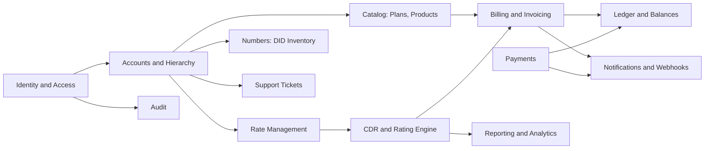
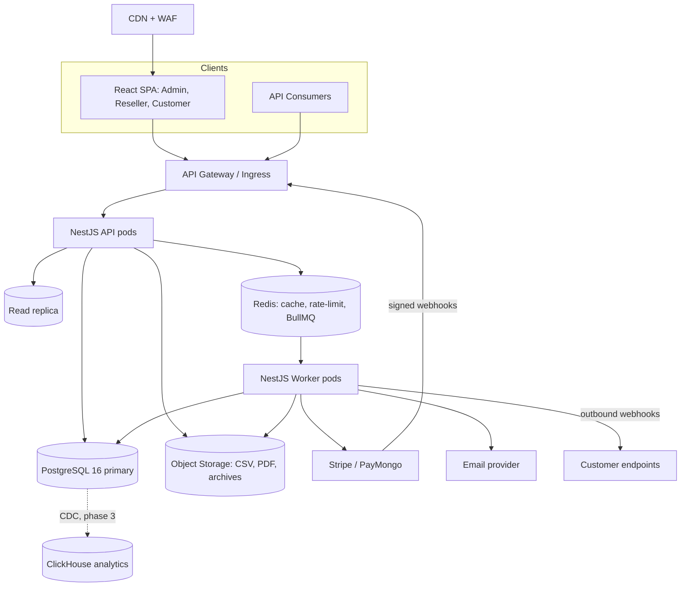
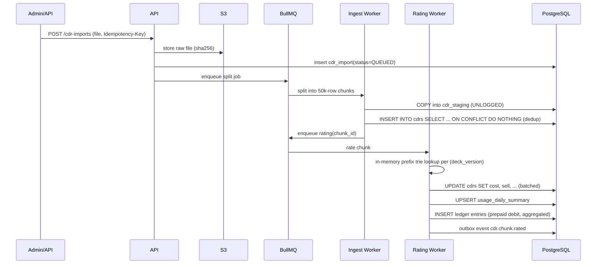
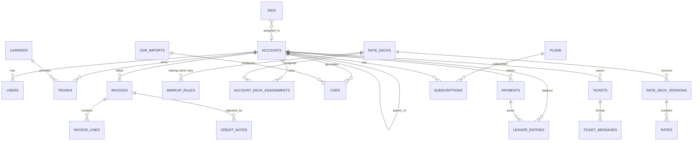

# RateDeck — Enterprise VoIP Rating, Billing & Reseller Platform
### Master Architecture & Delivery Plan

> Built from [README.md](file:///c:/Users/rafael/Documents/GitHub/RateDeck/README.md). It's written from the 10 viewpoints you asked for (Fellow, Architect, DBA, DB Designer, BA, UX, Web Design, React, NestJS, QA). Every section links back to a README feature.

---

## 0. Executive Summary (L10 / Google Fellow view)

RateDeck is a **multi-tenant wholesale telecom billing platform** with three account tiers (Admin → Reseller → Customer). Its core does three jobs:

1. **Rating**: turn raw CDRs into money. Uses longest-prefix match, effective-dated rates, billing increments and markup chains.
2. **Ledger**: keep balances, invoices, payments and credit notes correct and auditable. Uses double-entry bookkeeping.
3. **Hierarchy**: let resellers run their own white-labelled business on top of the platform.

**Guiding principles**
| # | Principle | Consequence |
|---|---|---|
| P1 | **Money is never a float** | `NUMERIC` in the DB, `decimal.js` in TS, banker's rounding only when an invoice is finalised |
| P2 | **Published history never changes** | Rate deck versions, invoices and ledger entries can only be added to. Changes are made with new versions or compensating entries |
| P3 | **Every async operation is idempotent** | Idempotency keys on CDR import, webhooks, payments and invoice runs |
| P4 | **Modular monolith first, services later** | Strict module boundaries now, so Rating/CDR can be pulled out into separate services without a rewrite |
| P5 | **Tenant isolation at the database layer** | PostgreSQL Row-Level Security is the safety net under app-level authorisation |
| P6 | **Design for 10× the volume** | Partitioning, summary tables and queues from day one. ClickHouse is the escape hatch for analytics |

**Key bets and trade-offs**
- **PostgreSQL 16** is the single system of record. It handles OLTP and partitioned CDRs well into the low billions of rows. Past that, CDR analytics moves to ClickHouse through CDC. The ledger stays in Postgres either way.
- **NestJS modular monolith + separate worker processes** sharing one codebase. One deployable keeps operations simple, and scaling still works because API and workers scale independently.
- **One React SPA with three portal shells** instead of three separate apps. The design system, auth and data layer are shared, and white-labelling is done with runtime theme tokens.

---

## 1. Business Analysis (Senior BA)

### 1.1 Personas
| Persona | Goals | Key pain points |
|---|---|---|
| **Platform Admin** (NOC/Finance) | Keep carrier costs and decks correct, protect margin, fix billing errors | Bad CSV imports, overlapping rates, re-rating after disputes |
| **Reseller** | Mark up wholesale rates, onboard customers, track margin | No visibility into cost vs. sell, branding |
| **Customer** (SMB/Call center) | Know balance and spend, download invoices, manage numbers | Surprise bills, running out of prepaid balance mid-campaign |
| **Developer (API consumer)** | Automate provisioning and billing sync | Inconsistent APIs, missing webhooks |

### 1.2 Domain Glossary (Ubiquitous Language)
| Term | Definition |
|---|---|
| **Rate Deck** | A named set of prefix-based rates (e.g. "Wholesale Premium USD") |
| **Deck Version** | A snapshot of the deck that can't be changed once published. It has its own effective window |
| **Prefix** | A string of leading digits on an E.164 number (`63917`). The longest match wins |
| **Billing Increment** | `first/next` seconds, e.g. `60/60`, `30/6`, `1/1` |
| **Connection Fee** | A flat charge per answered call |
| **Markup Deck** | A reseller deck that applies rules (%, fixed, override) on top of a parent deck |
| **CDR** | Call Detail Record |
| **Rating** | Working out cost and sell amounts for a CDR |
| **Re-rating** | Recalculating CDRs after a deck changes. Calls in already-invoiced periods produce adjustments |
| **Trunk** | A SIP interconnect with a carrier (cost side) or customer (sell side) |
| **DID** | Direct Inward Dial phone number |

### 1.3 Bounded Contexts


### 1.4 Key Business Rules (acceptance-test seeds)
- **BR-01** Within one deck version, two rate rows for the same prefix can't have overlapping effective ranges.
- **BR-02** Rating uses the deck version that was effective at the CDR's `start_time`, not at import time.
- **BR-03** `billed_seconds = 0` if `duration = 0`. Otherwise it's `first + ceil(max(0, duration − first) / next) × next`.
- **BR-04** `amount = connection_fee + billed_seconds × rate_per_min / 60`, kept at 8 decimal places.
- **BR-05** A reseller's sell rate is never below their cost unless the admin explicitly allows it (margin guard).
- **BR-06** Re-rating never changes a finalised invoice. The difference goes into a **credit note or debit adjustment**.
- **BR-07** A prepaid account below threshold gets alerts at 3 levels. At zero (or the credit limit for postpaid) it's auto-suspended.
- **BR-08** Impersonation only works downward in the hierarchy. Every impersonated action logs both the actor and the subject.
- **BR-09** Overdue invoices: reminders at D+1, D+7 and D+14, then suspension at D+N (configurable).

### 1.5 Non-Functional Requirements
| Category | Target |
|---|---|
| CDR ingestion | ≥ 20k CDR/s sustained per worker pool. 10M-row file fully rated in < 15 min |
| Rating latency | p99 < 2 ms per CDR in memory (trie cache) |
| API latency | p95 < 250 ms reads, < 500 ms writes |
| Reports | < 2 s over 12 months at 1B CDRs (served from summary tables) |
| Availability | 99.9% for portals/API. Rating pipeline can catch up (RPO 0, RTO 1 h) |
| Security | OWASP ASVS L2, WCAG 2.2 AA, PCI scope kept to gateway-hosted fields (SAQ-A) |
| Data retention | Raw CDRs 24 months hot, then archived to object storage (Parquet) |

---

## 2. System Architecture (Senior System Architect)

### 2.1 High-Level Topology


### 2.2 Runtime Processes (same codebase, different entrypoints)
| Process | Responsibility | Scaling signal |
|---|---|---|
| `api` | REST/OpenAPI, auth, portal BFF | CPU / RPS |
| `worker-ingest` | CSV parse → staging → dedup → insert | Queue depth `cdr-import` |
| `worker-rating` | Rating and re-rating, summary upserts | Queue depth `rating` |
| `worker-billing` | Invoice runs, PDFs, dunning, suspensions | Cron + queue |
| `worker-integration` | Payment webhooks, outbound webhooks, email | Queue depth |
| `scheduler` | One leader-elected cron runner (partition maintenance, cycles) | Single replica |

### 2.3 Core Architectural Patterns
- **Hexagonal / Clean Architecture per module**: `domain` (pure TS) ← `application` (use-cases) ← `infrastructure` (DB, queues, PSP adapters) ← `interface` (controllers, DTOs).
- **Transactional Outbox**: domain events are written to the `outbox` table in the same transaction, and a relay publishes them to BullMQ. A DB commit can never "succeed" while its event gets lost.
- **CQRS-lite**: writes go to normalised tables. Reads for dashboards and reports come from summary tables or the read replica.
- **Anti-Corruption Layer** for payment gateways and CDR sources (each CSV dialect has its own mapper).
- **Feature flags** (OpenFeature + Unleash/Flagd) for gradual rollout per tenant.

### 2.4 Rating Pipeline (the heart of the system)


**Longest-prefix match strategy (layered)**
1. **Hot path**: an in-memory **compressed trie** per published deck version, loaded lazily into each rating worker. It's invalidated over Redis pub/sub when a version is published. Versions can't change once published, so cache entries never go stale.
2. **Fallback / ad-hoc (API "quote a number")**: SQL with candidate prefixes:
   ```sql
   SELECT * FROM rates
   WHERE deck_version_id = $1
     AND prefix = ANY($2::text[])          -- ['6','63','639','6391','63917',...]
     AND effective @> $3::timestamptz
   ORDER BY length(prefix) DESC LIMIT 1;
   ```
   Backed by a B-tree index on `(deck_version_id, prefix)`.

**Re-rating**
- Triggered when a deck version is published with a backdated effective window, or manually by an admin for a date range.
- Creates a `rating_run`, selects the affected CDRs by `(account, start_time range, prefix set)`, and re-rates them in chunks.
- Each changed CDR gets a row in `cdr_rating_history` (old/new amounts).
- Summaries are adjusted by the delta.
- **Invoiced periods**: the deltas are added up into `pending_adjustments` and land on the next invoice as a credit note or debit line (BR-06).

### 2.5 Multi-Tenancy and Hierarchy
- `accounts` table with `type ∈ {platform, reseller, customer, sub_account}` and an `ltree` `path` (e.g. `root.r_12.c_884`).
- **Authorisation scope** = the subtree under the caller's `path`. Queries use `path <@ $scope`, backed by a GiST index.
- **Postgres RLS**: every tenant table carries `account_path`. Each request transaction runs `SET LOCAL app.scope = '<path>'`, and the policies enforce `account_path <@ current_setting('app.scope')::ltree`.
- **Impersonation**: an exchange token with an `act` claim (RFC 8693 style). The UI shows a persistent red banner. Every audit row records `actor_user_id` + `effective_user_id`.

### 2.6 Security Architecture
| Area | Design |
|---|---|
| Passwords | Argon2id, breached-password check (k-anonymity HIBP) |
| Sessions (web) | 15 min access JWT (EdDSA) + rotating refresh token in an `httpOnly; Secure; SameSite=Strict` cookie, with reuse detection |
| 2FA | TOTP (RFC 6238) + recovery codes. WebAuthn later |
| API tokens | `rd_live_<random>`. Only a SHA-256 hash is stored. Tokens carry scoped abilities (`cdr:read`, `invoice:read`, `payment:write`…) |
| Authorization | RBAC (role → permissions) + ABAC with CASL (ownership/subtree), shared between NestJS and React |
| Rate limiting | Redis sliding window per token, IP and route class. Returns `429` + `Retry-After` |
| Webhooks in | Gateway signature check + timestamp tolerance + `provider_event_id` unique |
| Webhooks out | HMAC-SHA256 `RateDeck-Signature: t=..,v1=..`, retries with exponential backoff for up to 72 h |
| Secrets | Cloud Secret Manager / Vault. Nothing in env files outside dev |
| Audit | Append-only `audit_log`, monthly partitions, optional hash chain (`prev_hash`) for tamper evidence |

---

## 3. Database Design (Senior DB Designer)

### 3.1 Conventions
- PKs: `bigint GENERATED ALWAYS AS IDENTITY` internally, plus a public `uuid` (v7, sortable) exposed through the API.
- Money: `NUMERIC(20,8)` for rates and rated amounts, `NUMERIC(18,2)` for invoice totals. Each row carries a `currency CHAR(3)`.
- Time: always `timestamptz`, stored in UTC. Each account has a `timezone` used for billing cycles.
- Effective dating: `tstzrange` + `EXCLUDE USING gist` to block overlaps (BR-01).
- Soft delete only where the business needs it (`archived_at`). Financial tables are never deleted from.

### 3.2 Core ERD


### 3.3 Key Table Sketches
```sql
-- Rate management
CREATE TABLE rate_decks (
  id bigint PRIMARY KEY GENERATED ALWAYS AS IDENTITY,
  public_id uuid NOT NULL UNIQUE,
  owner_account_id bigint NOT NULL REFERENCES accounts(id),
  kind text NOT NULL CHECK (kind IN ('carrier_cost','wholesale','markup')),
  parent_deck_id bigint REFERENCES rate_decks(id),       -- for markup decks
  currency char(3) NOT NULL,
  name text NOT NULL
);

CREATE TABLE rate_deck_versions (
  id bigint PRIMARY KEY GENERATED ALWAYS AS IDENTITY,
  deck_id bigint NOT NULL REFERENCES rate_decks(id),
  version int NOT NULL,
  status text NOT NULL CHECK (status IN ('draft','validating','published','archived')),
  effective tstzrange NOT NULL,
  source_file_sha256 text,
  published_by bigint, published_at timestamptz,
  UNIQUE (deck_id, version)
);

CREATE TABLE rates (
  id bigint GENERATED ALWAYS AS IDENTITY,
  deck_version_id bigint NOT NULL REFERENCES rate_deck_versions(id),
  prefix text NOT NULL CHECK (prefix ~ '^[0-9]{1,16}$'),
  destination text NOT NULL,
  rate_per_min numeric(20,8) NOT NULL CHECK (rate_per_min >= 0),
  connection_fee numeric(20,8) NOT NULL DEFAULT 0,
  increment_first smallint NOT NULL DEFAULT 60,
  increment_next smallint NOT NULL DEFAULT 60,
  effective tstzrange NOT NULL,
  PRIMARY KEY (deck_version_id, id),
  EXCLUDE USING gist (deck_version_id WITH =, prefix WITH =, effective WITH &&)
);
CREATE INDEX ON rates (deck_version_id, prefix);

-- CDRs: monthly range partitions
CREATE TABLE cdrs (
  id bigint GENERATED ALWAYS AS IDENTITY,
  start_time timestamptz NOT NULL,
  account_id bigint NOT NULL,
  account_path ltree NOT NULL,
  source_id smallint NOT NULL,
  external_call_id text NOT NULL,
  caller text, callee text NOT NULL,
  duration_sec int NOT NULL,
  disposition text NOT NULL,           -- ANSWERED, NO_ANSWER, BUSY, FAILED
  trunk_id bigint,
  -- rating outputs
  rating_status smallint NOT NULL DEFAULT 0, -- 0 pending,1 rated,2 unrateable
  matched_prefix text, billed_sec int,
  cost_amount numeric(20,8), sell_amount numeric(20,8), reseller_sell_amount numeric(20,8),
  rated_deck_version_id bigint, rating_run_id bigint,
  invoice_id bigint,
  PRIMARY KEY (start_time, id),
  UNIQUE (start_time, source_id, external_call_id)   -- dedup (partition key included)
) PARTITION BY RANGE (start_time);
```

### 3.4 Ledger (double-entry)
- `ledger_accounts` (per customer: `receivable`, `prepaid_balance`, `revenue`, `tax_payable`…).
- `ledger_transactions` (one business event) → `ledger_entries` (debit/credit lines whose amounts must add up to zero, enforced by a deferred constraint trigger).
- `account_balances` is a cached projection, updated in the same transaction and guarded by `version` (optimistic locking).
- Prepaid usage posts **aggregated debits per rating chunk**, not one per CDR, which keeps write amplification low.

### 3.5 Supporting Tables (summary)
`users`, `roles`, `permissions`, `user_roles`, `api_tokens`, `mfa_factors`, `sessions`, `impersonation_sessions`, `audit_log` (partitioned), `carriers`, `trunks`, `sip_accounts`, `dids`, `did_assignments`, `plans`, `products`, `subscriptions`, `billing_cycles`, `tax_rules`, `fx_rates`, `invoices`, `invoice_lines`, `credit_notes`, `adjustments`, `payments`, `refunds`, `payment_webhook_events`, `webhook_endpoints`, `webhook_deliveries`, `outbox`, `cdr_imports`, `cdr_import_chunks`, `rating_runs`, `cdr_rating_history`, `usage_daily_summary`, `usage_monthly_summary`, `branding_profiles`, `notifications`, `tickets`, `ticket_messages`, `settings`.

---

## 4. Database Operations (Senior DBA)

| Concern | Plan |
|---|---|
| **Partitioning** | `cdrs`, `audit_log` and `cdr_rating_history` are partitioned by month. **pg_partman** creates partitions 3 months ahead. Old partitions are detached → exported to Parquet on S3 → dropped |
| **Indexes per partition** | `(account_id, start_time)`, `(rating_status) WHERE rating_status=0` (partial), BRIN on `start_time`, `(callee text_pattern_ops)` for search |
| **Bulk load** | `COPY` into an `UNLOGGED` staging table, then `INSERT … SELECT … ON CONFLICT DO NOTHING`. Indexes stay on (the partitions are small). Batches of 50k |
| **Summaries** | `usage_daily_summary(account_id, day, destination, deck_version_id)` is incrementally upserted by rating workers. A nightly reconcile job checks it against raw data |
| **Connection mgmt** | PgBouncer in transaction mode. `SET LOCAL` only (session-safe for RLS) |
| **Read scaling** | Reports and exports go to the read replica. Replica-lag guard (> 30 s → fall back or warn) |
| **Vacuum / bloat** | Per-partition autovacuum tuning. Current partition gets aggressive settings, older partitions get frozen |
| **Backups** | PITR (WAL archiving, 14 days) + daily snapshots. Restore drill every quarter |
| **Migrations** | Expand → migrate → contract. Run online with `lock_timeout`/`statement_timeout`. Never take long `ACCESS EXCLUSIVE` locks |
| **Monitoring** | `pg_stat_statements`, auto_explain (> 500 ms), lock waits, replication lag, partition count alerts |
| **Seeder** | A node script streams synthetic CDRs straight into `COPY FROM STDIN`. Realistic distribution: Zipf over destinations, diurnal curve, 60% answer rate. **Targets: 10M rows in < 5 min, 100M overnight** |

---

## 5. Backend — NestJS (Senior NestJS Developer)

### 5.1 Stack
NestJS 11 · TypeScript (strict) · **Drizzle ORM** (typed schema, SQL-first; raw SQL/COPY via `pg` for hot paths) · BullMQ · Zod (shared schemas → DTOs via `nestjs-zod`) · CASL · Pino · OpenTelemetry · `@nestjs/swagger` (OpenAPI 3.1) · `decimal.js` · Puppeteer/Gotenberg for invoice PDFs · React Email for templates.

### 5.2 Module Map
```
apps/api/src/modules/
  iam/            auth, mfa, sessions, api-tokens, impersonation, rbac
  accounts/       accounts hierarchy, users, branding, credit limits
  carriers/       carriers, trunks
  rates/          decks, versions, import/validate/publish, markup rules, quote
  numbers/        DID inventory, assignment, SIP accounts
  catalog/        plans, products, subscriptions
  cdr/            imports, chunks, search, export
  rating/         rating engine (domain), runs, re-rating
  billing/        cycles, invoice runs, lines, tax, credit notes, dunning
  ledger/         ledger transactions, balances, top-ups
  payments/       gateway ports, Stripe/PayMongo adapters, webhooks, refunds
  webhooks/       outbound endpoints, deliveries
  reports/        usage, revenue/margin, quality (ASR/ACD)
  notifications/  email, in-app, low-balance alerts
  support/        tickets, messages, internal notes
  audit/          audit log writer & query
  platform/       settings, currency/FX, feature flags, health
libs/
  shared-kernel/  Money, Result, DomainEvent, Clock, IdempotencyKey
  database/       drizzle schema, tx manager, RLS scope interceptor
  queue/          BullMQ wrappers, outbox relay
  contracts/      zod schemas shared with frontend
```

### 5.3 Module Internal Layout (example: `rates`)
```
rates/
  domain/        RateDeck.ts, DeckVersion.ts (state machine), Rate.ts, PrefixTrie.ts, BillingIncrement.ts
  application/   commands/ (ImportDeckCsv, PublishVersion), queries/ (QuoteNumber), events/
  infrastructure/ rate.repository.ts, csv-parsers/, trie-cache.redis.ts
  interface/     http/rates.controller.ts, dto/, jobs/deck-import.processor.ts
  rates.module.ts
```
Rules are enforced with **eslint-plugin-boundaries / dependency-cruiser**: modules only talk through their `application` public API or domain events. Nothing reaches into another module's tables.

### 5.4 Cross-Cutting
- **Request pipeline**: `CorrelationId` → `Auth guard` (JWT/API token) → `Ability guard` (CASL) → `TenantScope interceptor` (opens tx + `SET LOCAL app.scope`) → `Idempotency interceptor` (Redis + DB, for `POST`) → controller → `Problem+JSON` exception filter (RFC 9457).
- **API versioning**: URI `/v1`. Breaking changes → `/v2`, with `Sunset` headers on the old version.
- **Pagination**: cursor-based (`?cursor=&limit=`) for CDRs. Offset is allowed only for small admin lists.
- **Rate deck CSV import**: streaming parse (`csv-parse`) → validation report (bad prefixes, duplicates, overlaps, rate jumps > X%) → a **diff preview vs. current version** (added/removed/increased/decreased) → admin publishes.

### 5.5 Public REST API (v1 excerpt)
| Resource | Endpoints |
|---|---|
| Customers | `GET/POST /v1/customers`, `GET/PATCH /v1/customers/{id}` |
| Call records | `GET /v1/call-records?from&to&callee&cursor`, `POST /v1/call-records/exports` |
| Balance | `GET /v1/balance`, `POST /v1/top-ups` |
| Invoices | `GET /v1/invoices`, `GET /v1/invoices/{id}`, `GET /v1/invoices/{id}/pdf` |
| Payments | `GET/POST /v1/payments`, `POST /v1/payments/{id}/refunds` |
| Rates | `GET /v1/rates/quote?number=` |
| Webhooks | `GET/POST/DELETE /v1/webhook-endpoints`. Events: `invoice.created`, `invoice.paid`, `invoice.overdue`, `payment.succeeded`, `payment.failed`, `balance.low` |

---

## 6. Frontend — React (Senior React Developer)

### 6.1 Stack
React 19 · TypeScript strict · Vite · **TanStack Router** (type-safe, file-based, loaders) · **TanStack Query** (server state) · Zustand (small UI state only) · React Hook Form + Zod (shared `contracts`) · TanStack Table + TanStack Virtual (million-row-friendly grids) · Radix UI primitives (accessible, unstyled) · **Vanilla CSS with CSS Modules + design tokens (CSS custom properties)** · Recharts/ECharts · i18next · `orval` to generate a typed API client from OpenAPI.

### 6.2 App Structure (feature-sliced)
```
apps/web/src/
  app/            providers, router, theme bootstrap (white-label), error boundaries
  shells/         AdminShell, ResellerShell, CustomerShell (nav, permissions)
  features/
    auth/ accounts/ rate-decks/ cdrs/ billing/ payments/ numbers/
    reports/ support/ api-keys/ branding/ impersonation/
  entities/       account, invoice, rate, cdr (types, formatters, small UI)
  shared/
    ui/           design-system components (Button, DataGrid, Money, Drawer, ...)
    lib/          money (decimal.js), dates (tz-aware), csv, permissions (CASL)
    api/          generated client + query keys factory
```

### 6.3 Patterns
- **Route-level code-splitting** per portal. The customer bundle never ships admin code.
- **Permission-aware UI**: `<Can I="publish" a="RateDeck">` uses the same CASL rules as the backend.
- **Server-driven tables**: filters, sorts and cursors live in the URL search params (shareable, back-button safe).
- **Long-running jobs** (imports, exports, re-rates): a job tray with live progress over **SSE** (`/v1/jobs/stream`).
- **Optimistic updates** only for low-risk actions (ticket status). Financial actions always wait for the server.
- **Error/empty/loading states** are standard components. Skeletons, never spinners on whole pages.
- **Performance budgets**: initial JS < 200 kB gz per shell, LCP < 2.0 s, INP < 200 ms.

---

## 7. UX Design (Senior UI/UX)

### 7.1 Information Architecture
| Admin | Reseller | Customer |
|---|---|---|
| Dashboard (revenue, margin, ASR/ACD, import health) | Dashboard (my margin, customers at risk) | Dashboard (balance, cycle spend, forecast) |
| Accounts → Resellers / Customers | Customers & Sub-accounts | Call Records |
| Carriers & Trunks | Markup Decks | Invoices & Payments |
| Rate Decks (versions, import, diff, publish) | Credit Limits | Top-up |
| CDR Imports & Rating Runs | Margin & Commission Reports | Numbers & SIP Accounts |
| Numbers (DID inventory) | Branding | API Keys & Webhooks |
| Plans & Products | Support | Support |
| Billing (cycles, invoice runs, dunning) | | |
| Reports · Support · Audit Log · Settings | | |

### 7.2 Signature Flows (designed and usability-tested first)
1. **Rate deck import → validate → diff → publish**: a 4-step wizard. The diff is shown as a heatmap (rate increases in amber, decreases in teal), and publish needs a typed confirmation plus an effective date picker that shows timezone.
2. **CDR search**: a filter bar with chips. Results load as you scroll in a virtualised grid. A row drawer shows the rating breakdown (matched prefix → increment → fee → amount), which makes billing disputes easy to explain.
3. **Impersonation**: "View as" → persistent banner showing who you're acting as and an "Exit" button. Destructive actions need re-confirmation.
4. **Prepaid top-up**: one-click amounts, saved cards via the gateway's hosted fields, instant balance update.
5. **Reseller markup builder**: rules table (destination/prefix group → % or fixed) with a live preview of cost vs. sell vs. margin.

### 7.3 UX Principles
- Information-dense but calm. Data tables are the main surface, with keyboard navigation and a **command palette (⌘K)**.
- Never show a number without context: currency, period and comparison delta always sit next to it.
- Progressive disclosure for advanced rating details.
- Accessibility: WCAG 2.2 AA, focus rings, reduced-motion support, screen-reader-labelled charts (data table fallback).

---

## 8. Visual Design System (Senior Web Designer)

- **Brand palette (default theme "Signal")**: Ink `hsl(225 30% 9%)`, Surface `hsl(225 25% 13%)`, Primary `hsl(252 85% 66%)` (violet), Accent `hsl(172 70% 48%)` (teal for gains), Warning `hsl(38 95% 58%)`, Danger `hsl(352 80% 60%)`. Dark mode first, with a light theme to match.
- **Typography**: *Inter* for UI, *JetBrains Mono* for prefixes, numbers and IDs (tabular-nums everywhere money shows up).
- **Tokens** (`--rd-color-*`, `--rd-space-*`, `--rd-radius-*`, `--rd-shadow-*`, `--rd-motion-*`). White-label overrides only touch brand tokens and are checked against AA contrast before they're saved.
- **Surfaces**: subtle glassmorphism on the shell (blurred top bar, layered cards), soft gradients on KPI cards, 1px hairline borders.
- **Motion**: 150–250 ms ease-out micro-interactions, animated number tickers on KPIs, skeleton shimmer. Everything respects `prefers-reduced-motion`.
- **Deliverables**: Figma library (tokens → `tokens.json` via Style Dictionary → CSS variables), Storybook with visual regression (Chromatic/Playwright snapshots).

---

## 9. Quality Assurance Strategy (Senior QA)

| Layer | Tooling | Focus |
|---|---|---|
| Unit | Vitest | Domain: billing increments, money rounding, deck state machine, markup chains |
| **Property-based** | fast-check | LPM always returns the longest match, billed_sec ≥ duration, sum(entries)=0 |
| **Golden-file rating** | Vitest + fixtures | ~500 curated CDRs × decks → expected amounts (regression lock) |
| Integration | Testcontainers (Postgres, Redis) | Repositories, RLS isolation, partitions, COPY ingestion, outbox |
| Contract | OpenAPI schema validation + Schemathesis fuzzing | API stays compatible |
| E2E | Playwright | Critical journeys per role (import → publish → rate → invoice → pay) |
| Visual | Storybook + Playwright snapshots | Design system regressions, white-label themes |
| Accessibility | axe-core in Playwright | Zero critical violations |
| Performance | k6 (API), custom harness (10M CDR ingest) | NFR targets in §1.5, gated in nightly CI |
| Security | Semgrep, npm audit/Snyk, OWASP ZAP baseline, tenant-escape tests | No cross-tenant reads, ever |
| Chaos/Resilience | Kill workers mid-chunk, duplicate webhooks | Idempotency, exactly-once effects |

**Quality gates**: coverage ≥ 85% on `domain/` folders, no failing golden tests, p95 regressions > 10% block merge, every PR runs a migration dry-run on a seeded snapshot.

---

## 10. Repository, DevEx & Delivery

### 10.1 Monorepo (pnpm + Nx)
```
RateDeck/
  apps/
    api/            NestJS (api + worker entrypoints)
    web/            React SPA
    seeder/         CDR & fixture generator
  libs/
    contracts/      zod schemas + generated OpenAPI types
    shared-kernel/  Money, Result, time utils (isomorphic)
    ui/             design system (React + CSS Modules)
    config/         eslint, tsconfig, prettier presets
  infra/
    docker/         docker-compose (pg, redis, minio, mailpit, stripe-cli)
    k8s/            Helm charts
    terraform/      cloud resources
  docs/
    adr/            Architecture Decision Records
    runbooks/
```

### 10.2 CI/CD (GitHub Actions)
lint → typecheck → unit → integration (Testcontainers) → build images → E2E on ephemeral preview env → migration dry-run → deploy staging → smoke → manual approval → prod (canary 10% → 100%). Nightly: perf + security scans + 10M CDR ingest benchmark.

### 10.3 Observability
OpenTelemetry traces (API → queue → worker linked by trace context) · Prometheus metrics (`cdr_ingested_total`, `rating_lag_seconds`, `queue_depth`, `invoice_run_duration`) · Grafana dashboards · Loki logs · Sentry (FE+BE) · SLO alerts on rating lag and API error budget.

---

## 11. Phased Roadmap

| Phase | Duration | Deliverables | Exit criteria |
|---|---|---|---|
| **0 Foundation** | 2 wks | Monorepo, CI, docker-compose, design tokens, DB baseline, ADRs 001–010 | Hello-world deployed to staging |
| **1 Identity & Accounts** (DONE) | 3 wks | Auth, 2FA, RBAC, hierarchy, RLS, impersonation, audit log, portal shells | Tenant-escape test suite green |
| **2 Rate Management** (DONE) | 3 wks | Carriers/trunks, decks, versions, CSV import + diff + publish, quote API, markup decks | Golden LPM tests green |
| **3 CDR & Rating** (DONE) | 4 wks | Partitioned CDRs, chunked ingest, dedup, rating engine, summaries, re-rating, seeder | 10M CDR benchmark meets NFR |
| **4 Billing & Ledger** (DONE) | 4 wks | Ledger, plans/subscriptions, DIDs, cycles, invoices + PDF, tax, credit notes, dunning, suspension | Invoice reconciliation = ledger |
| **5 Payments** (DONE) | 2 wks | Stripe test + PayMongo adapters, webhooks, refunds, top-ups, receipts | Duplicate webhook chaos test passes |
| **6 API & Webhooks** (DONE) | 2 wks | Public v1 API, scoped tokens, rate limiting, outbound webhooks, OpenAPI portal | Schemathesis clean |
| **7 Reports, Support, Polish** (DONE) | 3 wks | Reports (usage, margin, ASR/ACD), tickets, notifications, white-label, a11y audit | Lighthouse ≥ 95, axe clean |
| **8 Hardening & Launch** (DONE) | 2 wks | Load/chaos tests, pen test fixes, runbooks, DR drill | Go/No-Go review |

**Phase 2+ evolution (Fellow view)**: pull `rating` into its own service once ingest passes ~50k CDR/s. Add ClickHouse for analytics past ~2B CDRs. Add real-time authorisation (balance check over an API to Kamailio/FreeSWITCH) as a separate low-latency service fed from the same trie snapshots.

---

## 12. Top Risks & Mitigations
| Risk | Impact | Mitigation |
|---|---|---|
| Rounding/increment bugs → billing disputes | High | Decimal everywhere, golden + property tests, rating breakdown visible to customers |
| Cross-tenant data leak | Critical | RLS + CASL + automated tenant-escape tests in CI |
| Re-rating mutating invoiced data | High | Locked periods, adjustments only (BR-06) |
| CDR volume outgrows Postgres | Medium | Partitioning + summaries now. ClickHouse CDC path designed |
| Duplicate payment/webhook processing | High | Provider event uniqueness + idempotency keys + outbox |
| Bad CSV deck published | High | Validation report, diff preview, staged publish, instant rollback to the previous version |

---

## 13. Confirmed Decisions

> [!NOTE]
> The following architectural decisions have been confirmed and will guide the implementation.

1. **CDR source**: Offline CSV import only.
2. **Expected scale**: ~1B+ CDRs/month (Enterprise scale). The architecture must handle this volume using Postgres partitioning and summary tables, with a clear path to ClickHouse if needed.
3. **Hosting target**: Single VPS with Docker Compose to start.
4. **Currency/tax**: Single currency (e.g., USD) with no complex tax.
5. **Payment gateway priority**: Stripe (test mode to start).
6. **ORM preference**: Drizzle ORM (best for SQL control and partitions).
7. **Team size and timeline**: Larger team build, allowing for parallel execution of the phased roadmap.

> [!TIP]
> The plan is now finalized. We can proceed with Phase 0: scaffold the Nx monorepo, docker-compose stack, design tokens, the initial Drizzle schema and the first ADRs.
